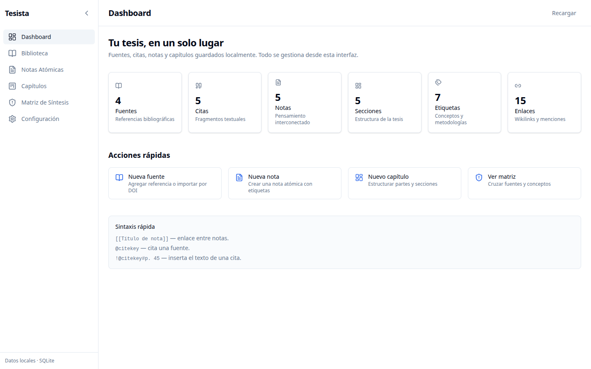
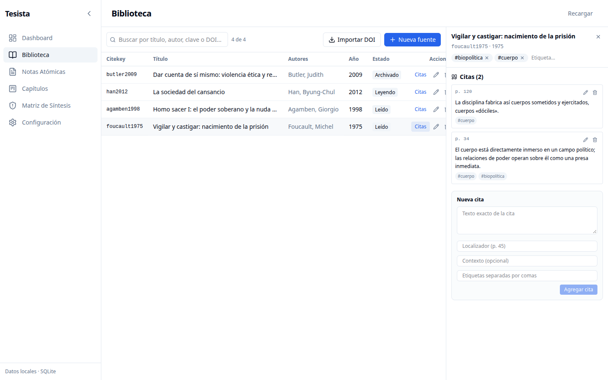
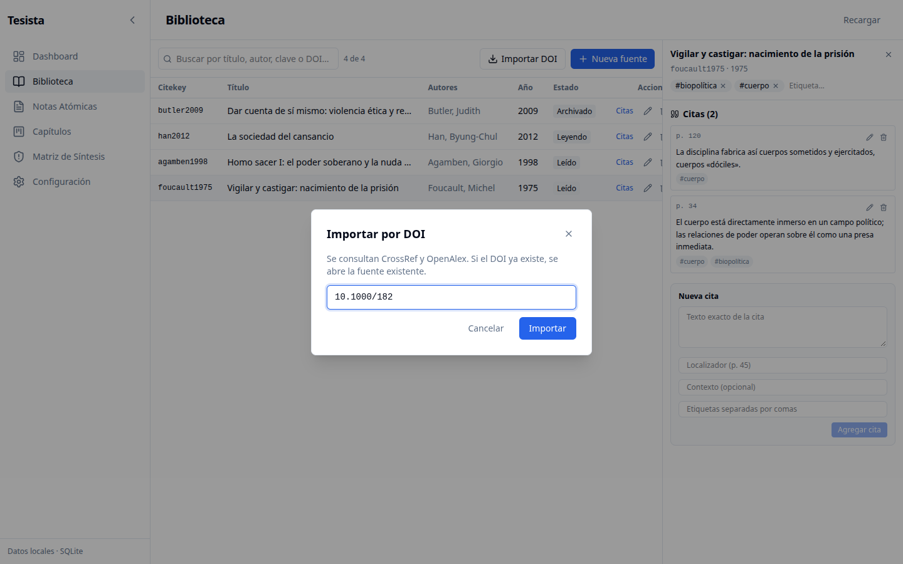
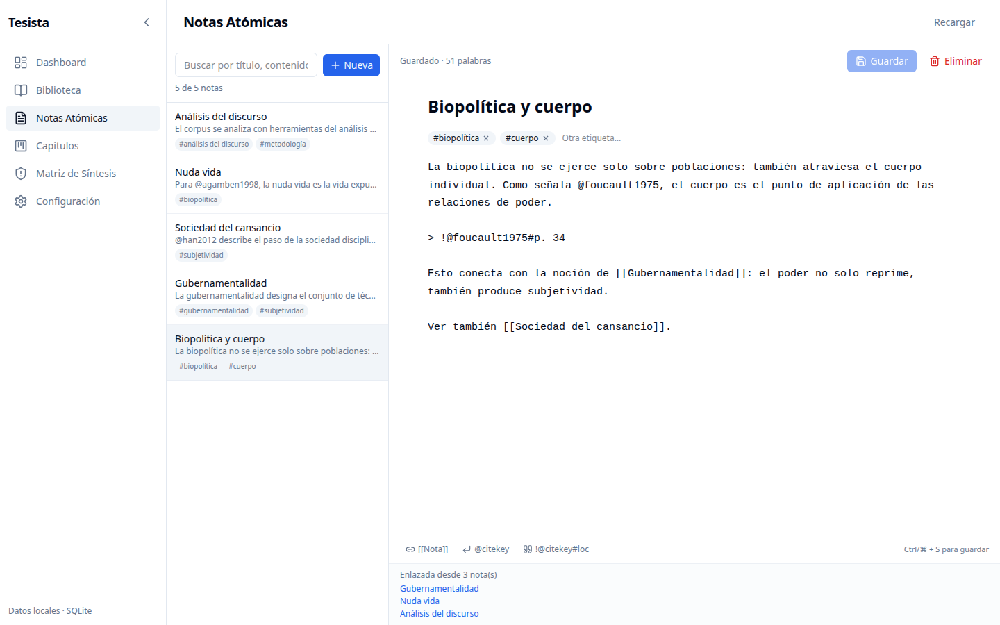
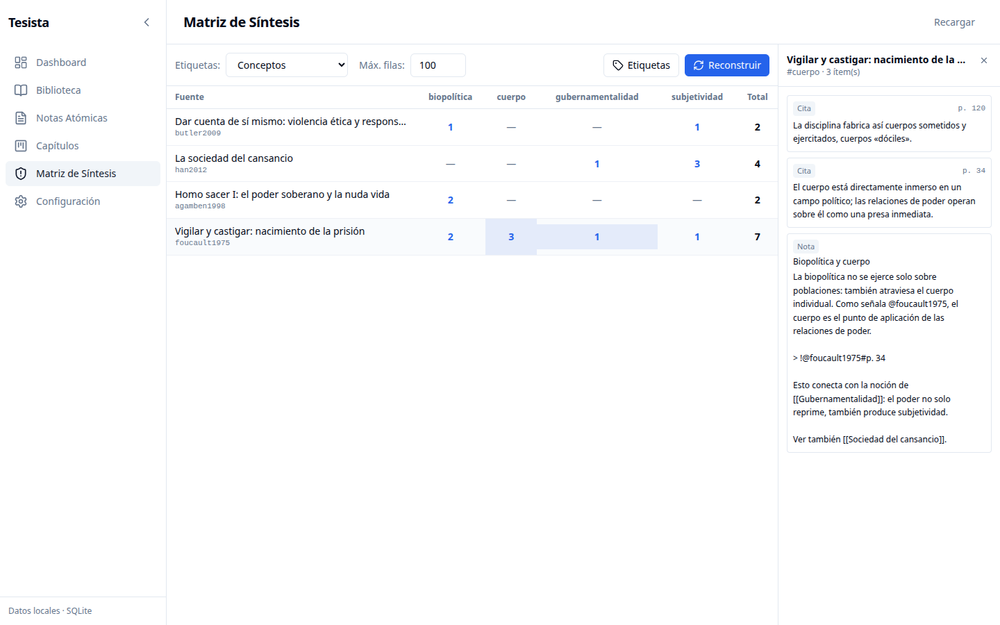
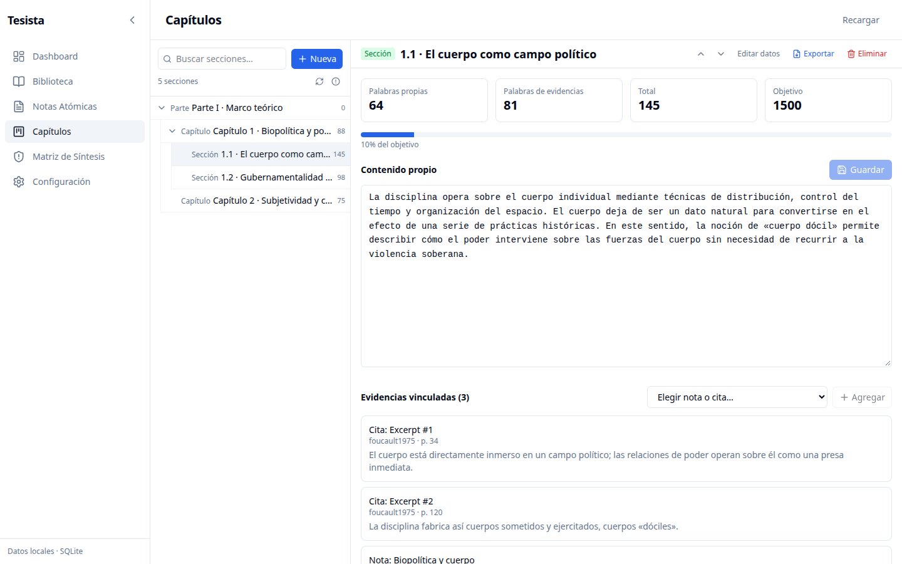
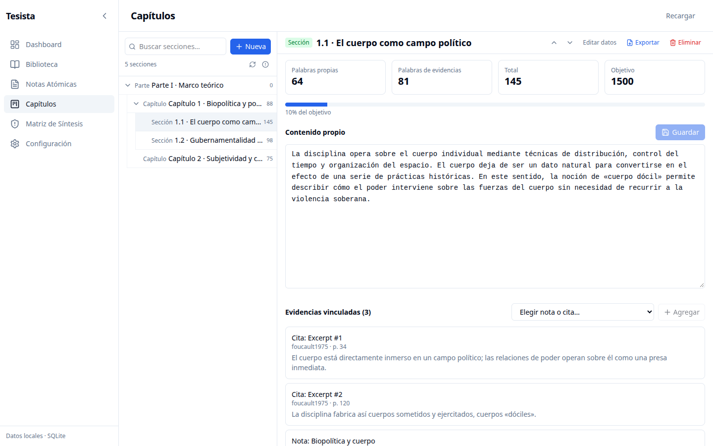
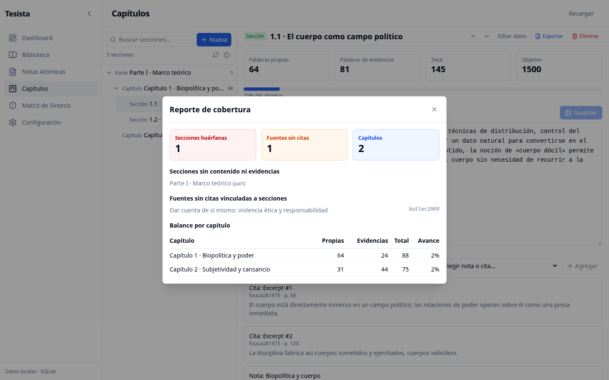
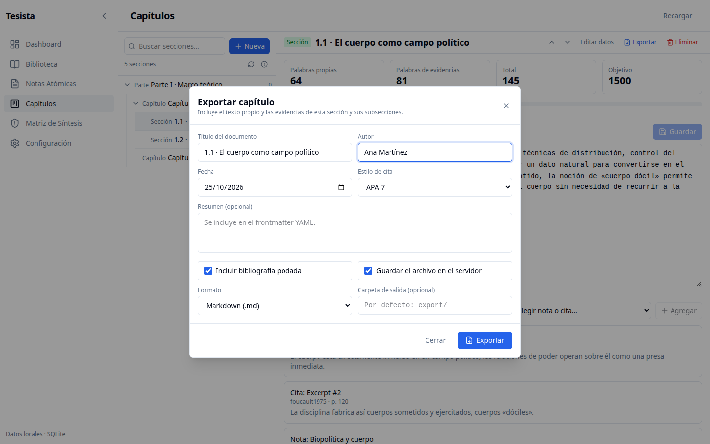
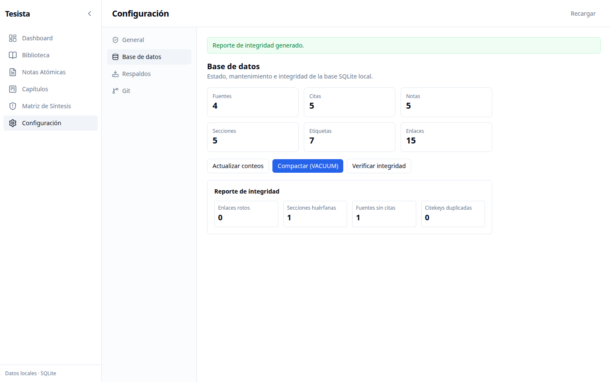

# Tesista - Plataforma de Gestión de Conocimiento para Tesis Doctorales

**Plataforma de gestión de conocimiento, referencias y cruce de datos para tesis doctorales**  
*(Combinando lo mejor de Zotero, Obsidian y Notion sin manejo de imágenes ni elementos distractores)*

> **Estado:** los seis hitos están completos y todo el flujo de trabajo se realiza desde el navegador. El repositorio versiona únicamente código, configuración y la base de datos local; dependencias y artefactos de build quedan fuera del historial.

---

## 1. Descripción del Proyecto

Tesista es una plataforma especializada para doctorandos que necesitan gestionar literatura científica, extraer citas textuales, desarrollar notas conceptuales atómicas, cruzar variables en matrices de síntesis y estructurar los capítulos de su tesis doctoral con trazabilidad total de evidencias.

El sistema está optimizado para **texto plano, metadatos estructurados, citas bibliográficas y relaciones multidireccionales**, sin elementos distractores como procesamiento de imágenes pesadas.

### Principios de Diseño

- **Trazabilidad Epistémica**: Cada afirmación en la tesis debe poder rastrearse hasta una nota conceptual, una cita textual y una fuente original con página exacta
- **Almacenamiento Local**: Base de datos SQLite portable y fácil de respaldar (orientada a proyectos de 3 a 5 años)
- **Enfoque en Texto**: Optimizado para texto plano y metadatos
- **Privacidad**: Los datos permanecen en la máquina del usuario

---

## 2. Arquitectura del Proyecto

```
tesista/
├── tesista.md              # Plan de desarrollo original (milestones 1-6)
├── README.md               # Este archivo
├── .gitignore              # Excluye dependencias, builds y salidas generadas
├── package.json            # Scripts y dependencias del núcleo (Node.js)
├── tsconfig.json           # Configuración TypeScript
├── data/
│   └── tesista.db          # Base SQLite local (versionada)
├── docs/
│   └── images/             # Capturas usadas en la guía de uso
├── scripts/
│   └── start-tesista.sh    # Arranca backend y frontend en paralelo
├── backups/                # (generado, ignorado) respaldos si el workspace es la app
├── export/                 # (generado, ignorado) capítulos exportados si el workspace es la app
│
├── src/                    # Capa de datos (Node.js + SQLite + TypeScript)
│   ├── types.ts            # Tipos de dominio compartidos
│   ├── citekey.ts          # Algoritmo de claves BibTeX (smith2020, smith2020a...)
│   ├── crossref.ts         # Cliente API pública de CrossRef
│   ├── openalex.ts         # Cliente API pública de OpenAlex
│   ├── bibtex.ts           # Parser y serializador BibTeX (Zotero/Mendeley)
│   ├── link-parser.ts      # Parser de [[wikilinks]], @citekey, !@cite#loc
│   ├── db.ts               # Capa de persistencia SQLite (milestones 1-4)
│   ├── query-parser.ts     # Parser de consultas declarativas (Hito 5)
│   ├── csl.ts              # Motor CSL: APA, Chicago, IEEE, MLA, Nature (Hito 5)
│   ├── pandoc.ts           # Wrapper Pandoc para exportación (Hito 5)
│   ├── export.ts           # Exportación académica: YAML frontmatter, BibTeX pruning (Hito 5)
│   ├── cascade.ts          # Actualización en cascada de citekeys y títulos (Hito 6)
│   ├── integrity.ts        # Diagnóstico de enlaces rotos y huérfanos (Hito 6)
│   ├── fts.ts              # Búsqueda de texto completo FTS5 (Hito 6)
│   ├── backup.ts           # Respaldos .tar.gz (Hito 6)
│   ├── git.ts              # Integración Git (Hito 6)
│   └── editor/             # Esqueleto de extensiones TipTap para el editor de notas
│       └── tiptap-extensions.ts
│
├── server/                 # API REST (Express + TypeScript)
│   ├── package.json
│   ├── tsconfig.json
│   ├── src/index.ts        # Endpoints REST para todos los recursos
│   └── dist/               # (generado, ignorado) build del servidor
│
└── frontend/               # Interfaz de usuario (React + Vite + Tailwind CSS)
    ├── package.json
    ├── vite.config.mts     # Configuración Vite (ESM) con proxy /api → 3001
    ├── postcss.config.js
    ├── tsconfig.json
    ├── tsconfig.node.json
    ├── index.html
    └── src/
        ├── main.tsx
        ├── index.css       # Tailwind v4 + tokens de tema (claro/oscuro)
        ├── api.ts          # Cliente tipado de la API REST
        ├── App.tsx         # Shell, Dashboard y navegación
        └── components/
            ├── Sidebar.tsx             (navegación lateral colapsable)
            ├── SourcesPage.tsx         (fuentes, DOI, citas y etiquetas)
            ├── NotesPage.tsx           (editor de notas con wikilinks, @citekey, transclusión y etiquetas)
            ├── SectionsPage.tsx        (árbol jerárquico, evidencias, progreso, Gap Checker y exportación)
            ├── MatrixPage.tsx          (matriz de síntesis y gestor de etiquetas)
            └── SettingsPage.tsx        (tema, mantenimiento, respaldos y Git)
```

---

## 3. Características por Hito

### Hito 1: Núcleo Bibliográfico (Tipo Zotero)

- **Base de datos SQLite local** con tablas `sources` y `excerpts` vinculadas por clave foránea
- **Generación automática de claves BibTeX**: `{apellido}{año}` con sufijo alfabético al colisionar (`smith2020`, `smith2020a`, `smith2020b`...)
- **Ingesta por API externa**: Clientes HTTP para CrossRef y OpenAlex con fallback en cadena
- **Entrada manual**: Si el DOI no existe o la API falla, se permite entrada completa sin bloquear
- **Importación/exportación BibTeX**: Parser y serializador para bibliotecas de Zotero/Mendeley
- **Validaciones obligatorias**:
  - Una cita (`Excerpt`) no puede crearse sin `source_id` asociado a una fuente existente
  - El campo **Página/Localizador** es obligatorio para trazabilidad epistémica

### Hito 2: Motor de Notas Atómicas (Tipo Obsidian)

- **Notas atómicas en Markdown** con título y contenido
- **Wikilinks**: Sintaxis `[[Título de nota]]` con soporte para alias `[[Título|Alias]]`
- **Menciones a fuentes**: Sintaxis `@claveBibTeX` para citar fuentes bibliográficas
- **Transclusión**: Sintaxis `!@claveBibTeX#localizador` para incrustar citas textuales como bloques de cita
- **Tabla de enlaces**: Persistencia de wikilinks, menciones y transclusiones
- **Backlinks**: Consulta de qué notas enlazan a una nota dada
- **Menciones no enlazadas**: Detección de títulos de notas que aparecen en texto plano sin wikilink explícito
- **Búsqueda full-text (FTS5)**: Índice sobre título y contenido de notas

### Hito 3: Matriz de Síntesis (Tipo Notion)

- **Etiquetas tipadas**: `concept`, `methodology`, `stance`, `custom` con color e ícono asociado
- **Vínculos polimórficos**: Tabla `item_tags` que vincula etiquetas con sources, excerpts o notes
- **Motor de filtros booleanos**: Operadores `eq`, `neq`, `like`, `ilike`, `in`, `is_null`, `is_not_null`, `gt`, `gte`, `lt`, `lte`, `has_tag`, `has_not_tag` con combinadores `AND`, `OR` y `NOT`
- **Matriz de síntesis**: Filas = fuentes, Columnas = etiquetas, Celdas = excerpts/notes vinculadas
- **Vistas guardadas**: Configuraciones de filtros, columnas y ordenamiento persistentes

### Hito 4: Estructura Capitular (Ensamblador de Tesis)

- **Árbol jerárquico**: Partes → Capítulos → Secciones → Subsecciones con `parent_id` y `position`
- **Reordenamiento eficiente**: Desplazamiento solo de hermanos afectados al mover nodos
- **Vinculación de evidencias**: Tabla `section_evidences` que asocia secciones con notas o excerpts, con campo `position` para orden lógico
- **Contador de palabras**: Desglose entre texto propio (`own_content`) y palabras de evidencias vinculadas
- **Dashboard de Cobertura (Gap Checker)**:
  - Secciones huérfanas (sin evidencias)
  - Fuentes con estado `filed` sin excerpts vinculados a ninguna sección
  - Balance por capítulo: ratio citas/palabras y progreso vs. meta

### Hito 5: Consultas Dinámicas y Exportación Académica

- **Parser de consultas declarativas**: Bloques ```query ... ``` con sintaxis YAML-like que se traducen a SQL nativo
- **Motor CSL (estilos de cita)**: APA 7th, Chicago Author-Date 17th, IEEE, MLA 9th, Nature
  - Citas entre paréntesis y citas narrativas
  - Múltiples citas agrupadas: `(@clave1#loc1; @clave2#loc2)`
- **Poda bibliográfica (BibTeX pruning)**: Exporta solo las fuentes citadas en un texto específico
- **YAML Frontmatter**: Generación automática de encabezado con título, autor, fecha, abstract, bibliografía y CSL
- **Exportación vía Pandoc**: Conversión de Markdown a PDF, LaTeX, DOCX, ODT, HTML, EPUB

### Hito 6: Rendimiento, Integridad y Experiencia de Usuario

- **Actualización en cascada**: Al renombrar título de nota o clave BibTeX, se escanea y reemplaza automáticamente todas las instancias `[[Nota Antigua]]` o `@claveAntigua` en el corpus
- **Diagnóstico de integridad**: Detección de enlaces rotos, secciones huérfanas, fuentes no citadas y claves duplicadas
- **Búsqueda de texto completo extendida**: Índices FTS5 para sources, excerpts, notes y sections; búsqueda difusa por trigramas
- **Respaldos**: Paquete `.tar.gz` con base de datos SQLite, JSON de todas las tablas y archivos Markdown planos; incluye restauración de un respaldo sobre la base activa con copia previa
- **Integración Git**: Elección del repositorio y su remoto, inicialización, commits con fecha y hora automáticas, push, pull (avance rápido o reemplazo), historial (log), estado (status), diffs y restauración de versiones
- **Interfaz completa en el navegador**: Dashboard con métricas, editor de notas grande, gestión de etiquetas, matriz interactiva y panel de configuración (tema oscuro, mantenimiento, respaldos y Git)

---

## 4. Cómo Instalar y Ejecutar

### Prerrequisitos

- **Node.js** v24 o superior
- **npm** v11 o superior
- **Git** (opcional, para integración de control de versiones)
- **Pandoc** (opcional, para exportación a PDF/LaTeX/DOCX)

### Opción 1: Usando el alias `tesista` (recomendado)

Si ya tenés el alias configurado, ejecutalo desde cualquier carpeta:

```zsh
tesista
```

Para crearlo en otro equipo, agregá esta línea a `~/.zshrc` (ajustá la ruta a tu clon):

```zsh
alias tesista='cd ~/Tesista && npm start'
```

Esto iniciará ambos servicios en paralelo:
- **Backend API**: `http://localhost:3001`
- **Frontend UI**: `http://localhost:5173`

Presiona `Ctrl+C` para detener ambos servicios.

### Opción 2: Manual

#### Backend (Servidor API)

Desde la raíz del repositorio:

```bash
cd server
npm install
npm run dev          # desarrollo con recarga (tsx watch)
```

El servidor estará disponible en `http://127.0.0.1:3001`.

Para ejecutar la versión compilada:

```bash
npm run build        # genera server/dist/
npm start            # node dist/server/src/index.js
```

#### Frontend (Interfaz de Usuario)

Desde la raíz del repositorio:

```bash
cd frontend
npm install
npm run dev
```

El frontend estará disponible en `http://localhost:5173` y redirige `/api` al backend.

Para comprobar tipos y generar la build de producción:

```bash
npm run typecheck
npm run build
npm run preview
```

#### Atajos desde la raíz

```bash
npm run dev:server     # inicia solo el backend
npm run dev:frontend   # inicia solo el frontend
npm run typecheck      # verifica el núcleo
npm start              # inicia ambos servicios con scripts/start-tesista.sh
```

> **Dependencias y artefactos:** el repositorio no versiona `node_modules/` ni builds. Al clonar, ejecutá `npm install` en la raíz (CLI), en `server/` y en `frontend/`; `npm start` instala automáticamente las dependencias de estos dos últimos si faltan. La base `data/tesista.db` sí se versiona.

### Opción 3: CLI (capa de datos directa)

El núcleo también incluye una interfaz de línea de comandos para pruebas y uso directo. Desde la raíz del repositorio:

```bash
npm install
npm run build        # compila TypeScript a dist/

# Ejemplos de uso:
node dist/index.js add-source "Título del artículo" "Autor" 2020 10.1234/xyz
node dist/index.js add-excerpt 1 "Texto de la cita textual" "p. 45" "Contexto"
node dist/index.js add-note "Mi nota" "Contenido con [[wikilink]] y @citekey"
node dist/index.js add-section "Capítulo 1" chapter
node dist/index.js section-tree
node dist/index.js gap-report
node dist/index.js resolve-doi 10.1038/s41586-020-2012-7
node dist/index.js import-bibtex biblioteca.bib
node dist/index.js export-bibtex
```

> La base de datos se guarda en `data/tesista.db`. Para usar otra ruta, definí `TESISTA_DB=/ruta/a/otra.db` antes de iniciar el backend o la CLI.
>
> El repositorio de trabajo (Git, respaldos y exportaciones) se elige desde **Configuración → Git**. También se puede fijar al arrancar con `TESISTA_WORKSPACE=/ruta/a/tu/tesis`; la configuración guardada en la app tiene prioridad.

---

## 5. Guía de uso

Esta sección recorre el flujo completo, desde el primer arranque hasta la exportación y el respaldo. Las capturas corresponden a una base de demostración y viven en `docs/images/`; podés reemplazarlas por las tuyas conservando el nombre del archivo.

### 5.1 Primer arranque

1. Desde la raíz del repositorio ejecutá `npm start` (o el alias `tesista`).
2. Abrí [http://localhost:5173](http://localhost:5173) en el navegador.
3. La app usa `data/tesista.db`; si no existe, crea la base y el esquema.
4. `Ctrl+C` detiene el backend y el frontend.

> Si la interfaz carga pero no muestra datos, el backend no está respondiendo. Revisá la sección 5.11.


*Dashboard: conteos de fuentes, citas, notas, secciones, etiquetas y enlaces, con acciones rápidas.*

### 5.2 Mapa de la interfaz

| Elemento | Para qué sirve |
|---|---|
| Menú lateral | Dashboard, Biblioteca, Notas Atómicas, Capítulos, Matriz de Síntesis y Configuración. La flecha superior lo colapsa. |
| Barra superior | Título de la página y **Recargar** para volver a leer los datos del backend. |
| Panel derecho | Detalle y edición del elemento seleccionado (fuente, nota o celda de matriz). |
| Modales | Crear fuente, nota o sección; importar DOI; exportar; reportes. |

### 5.3 Flujo de trabajo recomendado

1. **Cargar fuentes** en Biblioteca, a mano o importando el DOI (§5.4).
2. **Extraer citas textuales** con localizador obligatorio (§5.4).
3. **Escribir notas atómicas** que enlacen notas y transcluyan citas (§5.5).
4. **Etiquetar** fuentes, citas y notas, y revisar el cruce en la matriz (§5.7).
5. **Armar los capítulos**, escribir texto propio y vincular evidencias (§5.8).
6. **Revisar cobertura**, exportar el capítulo y crear un respaldo (§5.9 y §5.10).

Cada paso alimenta al siguiente: una cita queda disponible como evidencia, una nota puede enlazar varias fuentes y una sección combina texto propio con citas y notas.

### 5.4 Biblioteca


*Biblioteca con el panel de citas y etiquetas de una fuente.*

**Crear una fuente a mano**

1. **Biblioteca → Nueva fuente**.
2. Completá **Título** (obligatorio) y **Autores** separados por punto y coma: `Pérez, Ana; Gómez, Luis`.
3. Agregá año, revista/libro, editorial, tipo BibTeX y estado de lectura.
4. La **citekey** se genera sola (`foucault1975`, con sufijo `a`, `b` si se repite); también podés escribir una propia.
5. Guardá. La fuente aparece en la tabla con su estado.

**Importar por DOI**

1. **Importar DOI**, pegá el DOI (`10.1000/xyz123`) y confirmá.
2. Se consulta CrossRef y, si falla, OpenAlex.
3. Revisá los metadatos recuperados y guardá. Si el DOI ya existe, se abre la fuente existente.


*Importación de metadatos por DOI.*

**Agregar citas y etiquetas**

1. En la fila de la fuente, **Citas** abre el panel derecho.
2. En **Nueva cita** escribí el texto exacto, el **localizador** (`p. 45`, `§ 2.3`, `párr. 4`) y, si querés, contexto y etiquetas.
3. **Agregar cita**. El localizador es obligatorio: sin él el botón queda deshabilitado.
4. Las etiquetas se agregan en el campo **Etiqueta…** con `Enter` o coma; la `×` las quita.
5. Los iconos de lápiz y papelera editan o eliminan.

> Las citas son la unidad de trazabilidad: cada evidencia de un capítulo apunta a una cita con página o a una nota.

### 5.5 Notas atómicas


*Editor con etiquetas, Markdown y backlinks.*

1. **Notas Atómicas → Nueva** (o **Nueva nota** en el Dashboard).
2. Escribí un título y el contenido en Markdown.
3. Etiquetá con el campo **Otra etiqueta…** (`Enter` o coma).
4. Guardá con **Guardar** o `Ctrl/⌘ + S`. El indicador muestra *Cambios sin guardar* o *Guardado · N palabras*.
5. Con **Autoguardado** activo (Configuración), guarda 1,5 s después de dejar de escribir.
6. Al pie aparecen los **backlinks**: notas que enlazan a la actual.

**Sintaxis**

| Sintaxis | Ejemplo | Efecto |
|---|---|---|
| Wikilink | `[[Biopolítica y cuerpo]]` | Enlaza otra nota por título. |
| Alias | `[[Biopolítica y cuerpo\|biopoder]]` | Enlace con texto visible distinto. |
| Mención | `@foucault1975` | Referencia una fuente por citekey. |
| Transclusión | `!@foucault1975#p. 34` | Inserta el texto de la cita con ese localizador. |

Los botones `[[Nota]]`, `@citekey` y `!@citekey#loc` de la barra inferior insertan la sintaxis en el cursor.

> Al renombrar el título de una nota o una citekey, la actualización en cascada reescribe las referencias en todo el corpus.

### 5.6 Búsqueda y filtros

- **Biblioteca**: filtra en vivo por título, autor, citekey o DOI.
- **Notas**: filtra por título, contenido y etiquetas; el contador indica cuántas quedan.
- **Capítulos**: busca secciones por título dentro del árbol.
- **Matriz**: el selector **Etiquetas** define qué tipo de etiqueta se usa como columnas.

La búsqueda de texto completo FTS5 también está disponible por API (`POST /api/search/fts`, §6).

### 5.7 Matriz de síntesis


*Cruce de fuentes y etiquetas; al abrir una celda se listan sus citas y notas.*

1. Abrí **Matriz de Síntesis**.
2. Elegí el tipo de etiqueta en **Etiquetas:** (Conceptos, Metodologías, Posturas, Personalizadas).
3. Ajustá **Máx. filas** y usá **Reconstruir** para recalcular.
4. Cada fila es una fuente y cada columna una etiqueta; el número indica cuántas citas o notas cruzan esa combinación.
5. Clic en un número abre el detalle con el texto de cada ítem y su localizador.
6. **Etiquetas** abre el gestor: crear (nombre + tipo), renombrar y eliminar. Eliminar una etiqueta quita sus vínculos.

### 5.8 Capítulos y evidencias


*Árbol jerárquico y editor de una sección con métricas de palabras.*

1. **Capítulos → Nueva** y elegí el tipo: **Parte**, **Capítulo**, **Sección** o **Subsección**.
2. Definí el **Padre** (o *Sin padre* para una raíz) y el **Objetivo de palabras**.
3. Seleccioná un nodo para editar título, tipo, padre y objetivo en **Editar datos**.
4. Reordená entre hermanos con las flechas ↑/↓; el orden se guarda al instante.
5. Escribí el **Contenido propio** y guardá. El encabezado muestra palabras propias, de evidencias, total y el avance hacia el objetivo.
6. En **Evidencias vinculadas**, elegí una nota o cita en el selector, **Agregar**, y quitá con el icono de papelera.


*Evidencias vinculadas y progreso de palabras de la sección.*

**Reporte de cobertura (Gap Checker)**

El icono de alerta en la cabecera del árbol (junto al de recarga) abre el reporte:


*Secciones sin evidencias, fuentes sin citas vinculadas y balance por capítulo.*

- **Secciones huérfanas**: sin contenido propio ni evidencias.
- **Fuentes sin citas vinculadas**: fuentes archivadas (`filed`) cuyas citas no llegaron a ninguna sección.
- **Balance por capítulo**: palabras propias, de evidencias, total y avance.

### 5.9 Exportar un capítulo


*Exportación con metadatos, estilo de cita y formato de salida.*

1. Seleccioná la sección y usá **Exportar** (incluye la sección y sus subsecciones).
2. Completá título del documento, autor, fecha, estilo de cita y resumen opcional.
3. Marcá **Incluir bibliografía podada** para agregar solo las fuentes citadas.
4. Marcá **Guardar el archivo en el servidor** y elegí formato: Markdown, LaTeX, PDF, Word o Typst.
5. **Exportar** genera el resultado; **Descargar Markdown** lo baja desde el navegador.

La salida incluye frontmatter YAML, citas resueltas y bibliografía. Los formatos distintos de Markdown requieren **Pandoc** instalado; la carpeta por defecto es `export/` dentro del repositorio de trabajo (§5.10).

### 5.10 Configuración y respaldos


*Conteos, mantenimiento, integridad, respaldos y Git.*

**General**

- **Modo oscuro**: cambia la paleta de toda la app.
- **Autoguardado de notas**: guarda 1,5 s después de dejar de escribir.

**Base de datos**

- **Actualizar conteos**: relee fuentes, citas, notas, secciones, etiquetas y enlaces.
- **Compactar (VACUUM)**: recupera espacio del archivo SQLite.
- **Verificar integridad**: enlaces rotos, secciones huérfanas, fuentes sin citas y citekeys duplicadas.

**Respaldos**

1. Revisá el **repositorio de respaldo** que se muestra arriba: es la carpeta elegida en la pestaña **Git**.
2. Opcional: indicá una ruta de salida. Por defecto se usa `<workspace>/backups/tesista-<fecha>.tar.gz`; las rutas relativas se resuelven contra el workspace.
3. Marcá **Commitear el respaldo en el repositorio** para crear un commit con todos los cambios pendientes (incluidos tus documentos). Si además marcás **Subir al remoto (push)**, el commit se publica en `origin`.
4. **Crear respaldo ahora**.
5. El `.tar.gz` incluye la base con checkpoint del WAL, JSON de las tablas, notas en Markdown y un manifiesto.
6. **Restaurar un respaldo**: en **Respaldos disponibles** elegí un archivo y pulsá **Restaurar**. La app reemplaza la base activa con la incluida en el `.tar.gz` y antes guarda una copia de la base actual como `tesista.db.bak-<fecha>` junto al archivo original. Después podés recargar la página si ves datos desactualizados.

> Si la carpeta `backups/` está en el `.gitignore` del repositorio (o el archivo se guarda fuera de él), la app avisa que el respaldo no quedó versionado. En ese caso quitá esa regla o elegí otra ruta de salida. Para restaurar en otro dispositivo, el `.tar.gz` tiene que haber llegado por Git (o copiarlo a mano) y aparecer en `<workspace>/backups/`.

**Git: elegir el repositorio**

La app no está atada a su propio repositorio: puede versionar el repositorio de tu tesis.

1. **Ruta local**: escribí la carpeta del repositorio (por ejemplo `~/Documentos/Doctorado/Tesis`) y pulsá **Usar esta carpeta**. Se aceptan rutas absolutas y `~`.
2. **Remoto (origin)**: pegá la URL (`https://github.com/usuario/tesis.git` o `git@github.com:usuario/tesis.git`) y pulsá **Guardar remoto**. Si el repositorio todavía no existe, **Inicializar repositorio** lo crea y aplica el remoto guardado.
3. **Estado**: muestra rama, remoto, último commit, archivos pendientes y cuántos commits faltan subir o traer.
4. **Commit**: el mensaje es opcional; la app le agrega automáticamente la fecha y hora (`Tesista: instantánea · 2026-10-25 14:32:10`). Incluye todos los cambios pendientes del repositorio. Los archivos auxiliares de SQLite (`*.db-wal`, `*.db-shm` y las copias `*.db.bak-*`) se excluyen solos mediante `.git/info/exclude`, así el árbol no queda sucio por la base abierta.
5. **Push**: guarda automáticamente los cambios pendientes con un commit fechado y sube la rama activa a `origin`. Requiere credenciales de Git configuradas (token, credential helper o clave SSH); si faltan, la operación falla rápido con un mensaje claro.
6. **Pull**: trae los cambios de `origin` en modo *fast-forward*. Si hay archivos sin commitear, usá **Push** (guarda y sube) o **Commit** antes de traer. Si la rama local y la remota divergen, aparece **Traer y reemplazar**: guarda los cambios pendientes en un commit y una rama `tesista/seguridad-<fecha>`, y deja la rama igual al remoto. Es la opción recomendada cuando la base SQLite no se puede fusionar.
7. **Historial**, **Ver diff** y **Restaurar** permiten revisar y recuperar versiones anteriores. Restaurar crea un commit nuevo con los archivos de la versión elegida (no reescribe la historia) y guarda aparte los cambios pendientes.
8. **Restablecer** vuelve a usar la carpeta de la aplicación.

> El historial muestra la fecha y hora de cada commit y marca el **Más reciente**. La restauración de un commit afecta los archivos del repositorio; si la base SQLite vive dentro de él, también se restaura y el servidor la recarga. Para recuperar solo los datos de la app desde un `.tar.gz`, usá la pestaña **Respaldos**.
>
> La configuración se guarda en la base SQLite (`app_settings`), así que se conserva entre reinicios. Es independiente de dónde viva `tesista.db`: los respaldos copian la base al repositorio, pero la base activa sigue en `data/`. Al hacer Pull o restaurar, la app conserva la carpeta de trabajo y el remoto de cada dispositivo.
>
> Si preferís no usar la interfaz, definí `TESISTA_WORKSPACE` antes de arrancar; la app lo usa cuando no hay una carpeta configurada.

**Recuperar una versión anterior**

- **Desde el historial**: **Restaurar** sobre cualquier commit crea uno nuevo con esos archivos. No borra nada: el estado previo sigue en el historial y, si había cambios pendientes, quedan en un commit de seguridad.
- **Desde una rama de seguridad** (la crea «Traer y reemplazar»): listá las ramas con `git branch --list 'tesista/seguridad-*'`, mirá qué contienen con `git log --oneline <rama>` y volvé a esa versión con **Restaurar** desde la interfaz o con `git switch <rama>` (cerrá la app antes si `tesista.db` vive dentro del repositorio). Cuando ya no la necesites, borrala con `git branch -D <rama>`.
- **Desde la copia de la base**: al restaurar un respaldo se guarda `tesista.db.bak-<fecha>` junto a la base activa. Para volver atrás, cerrá la app, renombrá ese archivo como `tesista.db` (reemplazando la base actual) y volvé a iniciar.

**Trabajar desde varios dispositivos**

1. En el dispositivo A: pulsá **Push**. La app guarda primero los cambios pendientes con un commit fechado y después los sube. Si además querés sincronizar los datos de la app, creá un respaldo con **Commitear** y **Subir al remoto**, o versioná `data/tesista.db` manteniendo la carpeta de trabajo en el propio proyecto.
2. En el dispositivo B: si es la primera vez, cloná el repositorio con Git y elegí esa carpeta en **Configuración → Git**; si ya existe, pulsá **Pull**.
3. Si el Pull rechaza por cambios locales, pulsá **Push** (guarda y sube) o usá **Traer y reemplazar** (deja una rama de seguridad).
4. Si los datos de la app no viajaron con el repositorio, entrá en **Respaldos → Respaldos disponibles** y pulsá **Restaurar** sobre el `.tar.gz` más reciente.
5. Al terminar de trabajar, repetí **Push** (y un respaldo si corresponde).

### 5.11 Problemas frecuentes

| Síntoma | Causa probable | Solución |
|---|---|---|
| La interfaz carga pero no hay datos | Backend detenido o en otro puerto | Verificá `curl http://127.0.0.1:3001/api/stats`; reiniciá con `npm start`. |
| «EADDRINUSE» al arrancar | Puerto 3001 o 5173 ocupado | `lsof -i :3001 -i :5173` y cerrá el proceso anterior. |
| «database is locked» | Otra instancia usa la misma base | Cerrá la otra instancia; los archivos `-wal`/`-shm` se regeneran solos. |
| El DOI no se importa | DOI inexistente o API caída | Cargá la fuente a mano; el resto de la app sigue funcionando. |
| La exportación a PDF/DOCX falla | Pandoc no instalado | Instalá Pandoc o exportá en Markdown. |
| El push falla con «could not read Username» | Faltan credenciales para el remoto privado | Configurá un token/credential helper (`git config --global credential.helper store`) o usá una URL SSH con clave. |
| El pull falla con «Hay cambios sin commitear» | La base SQLite o tus documentos tienen cambios sin versionar | Hacé **Commit** y volvé a intentar, o usá **Traer y reemplazar** si querés descartar lo local (queda en una rama de seguridad). |
| El pull falla porque las ramas divergen | Hay commits locales y remotos a la vez | Pulsá **Traer y reemplazar** para adoptar el remoto; antes se guarda el estado local en un commit y una rama `tesista/seguridad-*`. |
| No sé dónde quedó la versión que reemplacé | «Traer y reemplazar» movió la rama local | Buscá la rama con `git branch --list 'tesista/seguridad-*'` y restaurá ese commit desde el historial, o volvé a la copia `tesista.db.bak-<fecha>` si solo querés los datos. |
| Restaurar un respaldo reemplazó datos actuales | La base activa se sobrescribió con el contenido del `.tar.gz` | La versión anterior está en `tesista.db.bak-<fecha>` (junto a la base) o en el commit/rama de seguridad. |
| Después de restaurar veo datos viejos en pantalla | La interfaz mantiene datos cargados en memoria | Recargá la página (F5); el servidor ya reabrió la base restaurada. |
| El respaldo se crea pero no se commitea | `backups/` está en el `.gitignore` del repositorio | Quitá esa regla o elegí otra ruta de salida dentro del workspace. |
| «La carpeta configurada no está disponible» | El workspace se movió o desmontó | Elegí la carpeta de nuevo en **Configuración → Git** o pulsá **Restablecer**. |
| Quiero empezar de cero | Datos de prueba | Creá un respaldo, renombrá `data/tesista.db` y reiniciá: se genera una base vacía. |

---

## 6. Endpoints de la API

El backend expone los siguientes endpoints REST:

| Módulo | Endpoint | Método | Descripción |
|--------|----------|--------|-------------|
| Sources | `/api/sources` | GET | Listar todas las fuentes |
| Sources | `/api/sources/:id` | GET | Obtener fuente por ID |
| Sources | `/api/sources/citekey/:citekey` | GET | Obtener fuente por clave BibTeX |
| Sources | `/api/sources` | POST | Crear nueva fuente |
| Sources | `/api/sources/:id` | PUT | Actualizar fuente |
| Sources | `/api/sources/:id` | DELETE | Eliminar fuente |
| Sources | `/api/sources/import-doi` | POST | Importar metadatos por DOI (CrossRef → OpenAlex) |
| Excerpts | `/api/excerpts` | GET | Listar citas |
| Excerpts | `/api/excerpts/:id` | GET | Obtener cita por ID |
| Excerpts | `/api/excerpts` | POST | Crear nueva cita |
| Excerpts | `/api/excerpts/:id` | PUT | Actualizar cita |
| Excerpts | `/api/excerpts/:id` | DELETE | Eliminar cita |
| Notes | `/api/notes` | GET | Listar todas las notas |
| Notes | `/api/notes/:id` | GET | Obtener nota por ID |
| Notes | `/api/notes` | POST | Crear nueva nota (acepta `tags`) |
| Notes | `/api/notes/:id` | PUT | Actualizar nota y sus etiquetas |
| Notes | `/api/notes/:id` | DELETE | Eliminar nota |
| Notes | `/api/notes/search?q=` | GET | Búsqueda full-text en notas |
| Notes | `/api/notes/:id/outgoing` | GET | Enlaces salientes de una nota |
| Notes | `/api/notes/:id/backlinks` | GET | Notas que enlazan a esta |
| Notes | `/api/notes/:id/unlinked` | GET | Menciones sin wikilink |
| Notes | `/api/notes/transclude?citekey=&locator=` | GET | Resolver transclusión |
| Sections | `/api/sections` | GET | Listar todas las secciones |
| Sections | `/api/sections/tree` | GET | Obtener árbol jerárquico con conteos |
| Sections | `/api/sections` | POST | Crear sección |
| Sections | `/api/sections/:id` | GET | Obtener sección por ID |
| Sections | `/api/sections/:id` | PUT | Actualizar sección (incluye `parentId: null`) |
| Sections | `/api/sections/:id/reorder` | POST | Reordenar sección |
| Sections | `/api/sections/:id` | DELETE | Eliminar sección |
| Sections | `/api/sections/:id/word-count` | GET | Conteo de palabras de sección |
| Sections | `/api/sections/:id/evidences` | GET | Evidencias de una sección |
| SectionEvidences | `/api/evidences` | POST | Vincular evidencia a sección |
| SectionEvidences | `/api/evidences/:id` | DELETE | Eliminar evidencia |
| Gap Report | `/api/gap-report` | GET | Reporte de cobertura y balance por capítulo |
| Tags | `/api/tags` | GET | Listar etiquetas |
| Tags | `/api/tags` | POST | Crear o recuperar etiqueta por nombre |
| Tags | `/api/tags/:id` | PUT | Actualizar etiqueta |
| Tags | `/api/tags/:id` | DELETE | Eliminar etiqueta y sus vínculos |
| ItemTags | `/api/item-tags` | POST | Vincular etiqueta a ítem |
| ItemTags | `/api/item-tags/:id` | DELETE | Quitar vínculo por ID |
| ItemTags | `/api/items/:itemType/:itemId/tags` | GET | Etiquetas de un ítem |
| ItemTags | `/api/items/:itemType/:itemId/tags` | PUT | Reemplazar etiquetas de un ítem |
| Matrix | `/api/matrix` | POST | Construir matriz de síntesis |
| SavedViews | `/api/views` | GET | Listar vistas guardadas |
| SavedViews | `/api/views` | POST | Guardar vista |
| Cascade | `/api/cascade/note-title` | POST | Renombrar nota con cascada |
| Cascade | `/api/cascade/citekey` | POST | Renombrar citekey con cascada |
| FTS | `/api/search/fts` | POST | Búsqueda de texto completo |
| Integrity | `/api/integrity` | GET | Diagnóstico de integridad |
| Stats | `/api/stats` | GET | Conteos de fuentes, citas, notas, secciones, etiquetas y enlaces |
| Workspace | `/api/workspace` | GET | Carpeta de trabajo, rama, remoto y rutas de respaldos/exportaciones |
| Workspace | `/api/workspace` | PUT | Elegir la carpeta de trabajo (`path`; `null` restablece) |
| Workspace | `/api/workspace/remote` | PUT | Guardar y aplicar el remoto `origin` (`url`) |
| Backup | `/api/backup` | POST | Crear respaldo .tar.gz (`outputPath`, `commit`, `push`, `message` opcionales) |
| Backup | `/api/backups` | GET | Listar respaldos disponibles en `<workspace>/backups` |
| Backup | `/api/backups/restore` | POST | Restaurar un respaldo sobre la base activa (`path`) |
| Export | `/api/export/chapter` | POST | Exportar capítulo (Markdown/LaTeX/PDF/DOCX/Typst) |
| Git | `/api/git/status` | GET | Estado del repositorio (rama, remoto, cambios) |
| Git | `/api/git/log?limit=` | GET | Historial de commits (fecha y hora) |
| Git | `/api/git/diff?from=&to=&file=` | GET | Diff entre commits |
| Git | `/api/git/commit` | POST | Crear commit (`message` opcional; se agrega fecha y hora) |
| Git | `/api/git/init` | POST | Inicializar repositorio y aplicar el remoto configurado |
| Git | `/api/git/push` | POST | Subir la rama activa a `origin` |
| Git | `/api/git/pull` | POST | Traer del remoto (`mode`: `ff-only` o `reset`) |
| Git | `/api/git/restore` | POST | Restaurar un commit como versión nueva (`commit`) |
| Maintenance | `/api/maintenance/vacuum` | POST | Compactar la base SQLite |

---

## 7. Tecnologías Utilizadas

### Backend
- **Node.js** v24
- **TypeScript**
- **SQLite** (`better-sqlite3`) - Base de datos local
- **Express** - Servidor API REST
- **CORS** - Middleware de origen cruzado

### Frontend
- **React** v19
- **Vite** - Herramienta de construcción
- **TypeScript**
- **Tailwind CSS** v4 - Estilos
- **Axios** - Cliente HTTP
- **Lucide React** - Iconos

### Dependencias del Núcleo
- **better-sqlite3** - SQLite síncrono para Node.js
- **node-fetch** (nativo en Node 24) - Cliente HTTP para APIs externas

---

## 8. Estructura de Datos (SQLite)

### Tablas Principales

| Tabla | Descripción |
|-------|-------------|
| `sources` | Fuentes bibliográficas (título, autores, año, DOI, citekey, estado de lectura) |
| `excerpts` | Citas textuales con localizador obligatorio (FK a sources) |
| `notes` | Notas atómicas en Markdown |
| `links` | Enlaces entre notas (wikilinks, menciones a fuentes, transclusiones) |
| `notes_fts` | Índice FTS5 para búsqueda en notas |
| `tags` | Etiquetas tipadas (concept, methodology, stance, custom) |
| `item_tags` | Vínculo polimórfico etiqueta → ítem (source/excerpt/note) |
| `saved_views` | Configuraciones de matriz y filtros guardadas |
| `sections` | Árbol jerárquico de partes/capítulos/secciones |
| `section_evidences` | Evidencias vinculadas a secciones con orden |
| `app_settings` | Preferencias persistentes (`workspace_path`, `git_remote`) |

---

## 9. Roadmap (Hitos Completados)

| Hito | Nombre | Estado |
|------|--------|--------|
| 1 | Núcleo Bibliográfico | ✅ Completado |
| 2 | Notas Atómicas y Enlaces Bidireccionales | ✅ Completado |
| 3 | Matriz de Síntesis y Filtros | ✅ Completado |
| 4 | Estructura Capitular y Gap Checker | ✅ Completado |
| 5 | Consultas Dinámicas y Exportación Académica | ✅ Completado |
| 6 | Rendimiento, Integridad y UX | ✅ Completado |

### Mejoras Futuras Posibles

- Arrastrar y soltar para reordenar secciones (hoy se usan flechas Subir/Bajar)
- Editor enriquecido con TipTap (el editor actual es Markdown plano)
- Migraciones de esquema versionadas y tests automatizados
- Paginación en listados grandes y optimización de consultas del árbol/matriz
- Soporte para archivos CSL externos (.csl)
- Fusión asistida de dos bases SQLite cuando ambos dispositivos tienen commits nuevos (hoy se elige una versión con «Traer y reemplazar»)
- Exportación de un archivo `.bib` separado para LaTeX

---

## 10. Licencia

ISC — según el campo `license` de `package.json`. El repositorio todavía no incluye un archivo `LICENSE`.

---

## 11. Soporte

Para problemas o sugerencias, abre un issue en el repositorio del proyecto.
